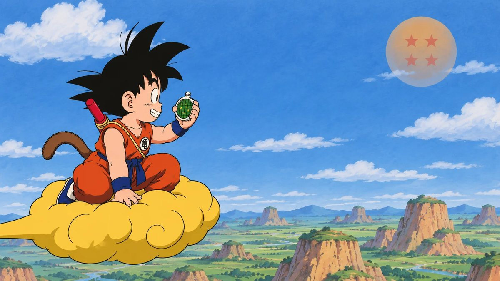

[← Catalog](../../../README.md)

# Goku: Four-Star Road

**Fan-made Dragon Ball beat 'em up through the Red Ribbon camp to Muscle Tower**

Kid Goku sets out alone to find his grandfather's four-star Dragon Ball. Fight through Colonel Silver's Red Ribbon camp, take the snow road to Muscle Tower and face Sergeant Metallic. Power Pole, flying kicks and the Kamehameha.

[**Play free**](https://app.usecrayon.ai/play/76dbd04f-0684-4486-8cc4-eae0585295e8?utm_source=github&utm_medium=awesome-list&utm_campaign=awesome-ai-games-and-demos&utm_content=goku-four-star-road) · [**Original gameplay**](https://x.com/aniketjart/status/2121793239175119279)

**November 26, 2026 update · Eighter joins Goku in the maze**

Android 8 (Eighter) joins Goku to help him find a way out of the maze. Aniket says two more levels are still to come.

This update credits [Fable 5.2](../../made-with/fable-5-2.md) · [Three.js](../../made-with/threejs.md) · [🖍️ Crayon](../../made-with/crayon.md).

[**Watch the update on X**](https://x.com/aniketjart/status/2125840506131522003)

Previous updates

**November 25, 2026 update · Ninja Murasaki and his brothers**

Aniket added Ninja Murasaki and his brothers to the Red Ribbon fan game, along with new models.

This update credits [Gemini Neon](../../made-with/gemini-neon.md) · [Fable 5.2](../../made-with/fable-5-2.md) · [Three.js](../../made-with/threejs.md) · [🖍️ Crayon](../../made-with/crayon.md).

[**Play this build**](https://app.usecrayon.ai/play/76dbd04f-0684-4486-8cc4-eae0585295e8?v=mwvl7kzu&utm_source=github&utm_medium=awesome-list&utm_campaign=awesome-ai-games-and-demos&utm_content=goku-four-star-road) · [**Watch the update on X**](https://x.com/aniketjart/status/2125437977371525313)

| | |
|---|---|
| **Type** | [Game](../../types/game.md) |
| **Genres** | [⚔️ Action](../../genres/action.md) · [🗺️ Adventure](../../genres/adventure.md) · [👊 Beat 'em up](../../genres/beat-em-up.md) |
| **Made by** | <a href="../../creators/aniketjart.md">Aniket</a> |
| **Made with** | [🖍️ Crayon](../../made-with/crayon.md) · [Fable 5.2](../../made-with/fable-5-2.md) · [Meshy](../../made-with/meshy.md) · [Tripo](../../made-with/tripo.md) · [ElevenLabs](../../made-with/elevenlabs.md) · [Opus 5.5](../../made-with/opus-5-5.md) · [GPT Images](../../made-with/gpt-images.md) · [Gemini Neon](../../made-with/gemini-neon.md) · [Three.js](../../made-with/threejs.md) |
| **Runs on** | [🌐 Web browser](../../platforms/web.md) |
| **Input** | keyboard |
| **Modes** | single-player |
| **Price** | free |
| **Tags** | [#fan-game](../../tags/fan-game.md) [#anime](../../tags/anime.md) [#dragon-ball](../../tags/dragon-ball.md) [#red-ribbon-army](../../tags/red-ribbon-army.md) [#android-8](../../tags/android-8.md) [#maze](../../tags/maze.md) [#ninja-murasaki](../../tags/ninja-murasaki.md) |
| **Note** | Fan-made, non-commercial |
| **Added** | 2026-11-15 |
