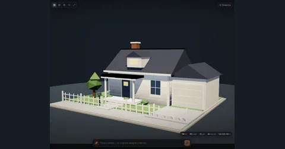

[← Catalog](../../../README.md)

# Low-Poly City Architecture Pack

**10 low-poly buildings with dedicated collision geometry.**

Build out a town with homes, shops, offices, and public buildings. Each GLB model has fewer than 1,000 triangles.

[**Download free**](https://usecrayon.itch.io/city-architecture)

| | |
|---|---|
| **Type** | [Asset pack](../../types/asset-pack.md) |
| **Formats** | GLB |
| **Made by** | <a href="../../creators/crayon.md">Crayon</a> |
| **Price** | free |
| **Tags** | [#3d](../../tags/3d.md) [#glb](../../tags/glb.md) [#low-poly](../../tags/low-poly.md) [#threejs](../../tags/threejs.md) [#city](../../tags/city.md) [#architecture](../../tags/architecture.md) [#collision-geometry](../../tags/collision-geometry.md) |
| **Note** | Name your own price on itch.io. |
| **Added** | 2026-11-18 |
