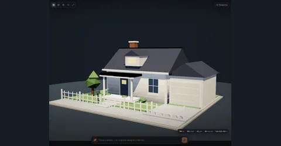
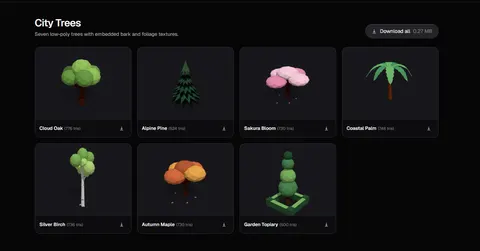

[← Catalog](../../README.md)

# #city

2 listings tagged **city**, newest first.

<table>
<tr>
<td width="25%" valign="top">
 
<b><a href="../showcase/l/low-poly-city-architecture-pack.md">Low-Poly City Architecture Pack</a></b> 
10 low-poly buildings with dedicated collision geometry. 
Asset pack · GLB · free · by <a href="../creators/crayon.md">Crayon</a> 
<a href="https://usecrayon.itch.io/city-architecture">Download free</a>
</td>
<td width="25%" valign="top">
 
<b><a href="../showcase/l/low-poly-city-trees-pack.md">Low-Poly City Trees Pack</a></b> 
7 stylized trees with embedded bark and foliage textures. 
Asset pack · GLB · free · by <a href="../creators/crayon.md">Crayon</a> 
<a href="https://usecrayon.itch.io/low-poly-city-trees-pack">Download free</a>
</td>
<td width="25%"></td>
<td width="25%"></td>
</tr>
</table>
